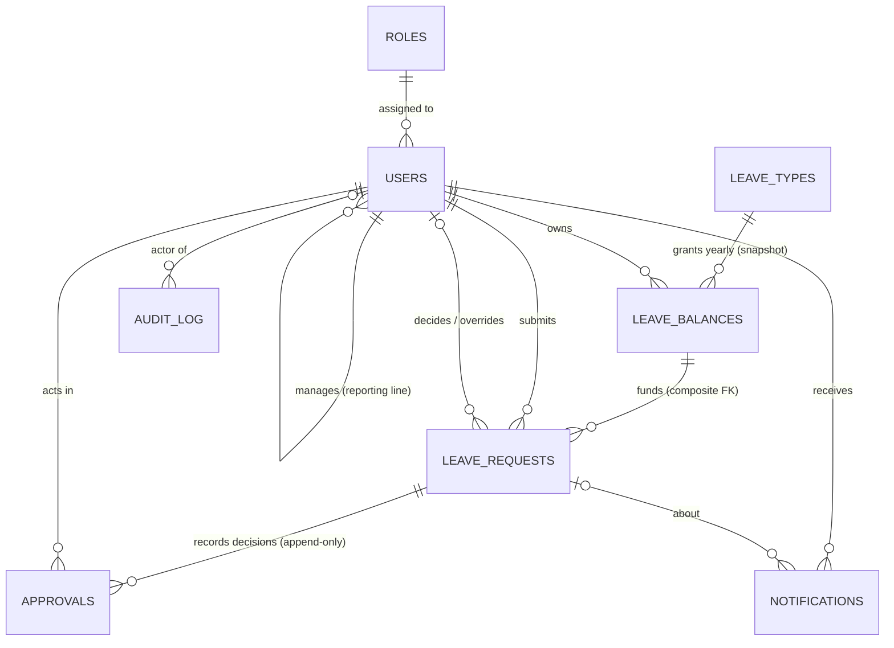

# Specification: Secure Employee Leave Management System

Version 1.0 · 2026-11-17 · Status: approved decisions assembled, presentation-ready.

Every decision in this document is **approved** and traceable:

| Area | Research | Approval |
| --- | --- | --- |
| Feature modules & role use cases | [#2](https://github.com/Wynteriall/leave-system/issues/2) → `research/feature-modules.md` | [#6](https://github.com/Wynteriall/leave-system/issues/6) |
| Security controls | [#5](https://github.com/Wynteriall/leave-system/issues/5) → `research/security-measures.md` | [#9](https://github.com/Wynteriall/leave-system/issues/9) |
| Data model | [#8](https://github.com/Wynteriall/leave-system/issues/8) → `research/data-model.md` | [#7](https://github.com/Wynteriall/leave-system/issues/7) |
| Tech stack & architecture | [#10](https://github.com/Wynteriall/leave-system/issues/10) → `research/tech-stack.md` | [#3](https://github.com/Wynteriall/leave-system/issues/3) |

Domain terms are defined in [`GLOSSARY.md`](../../GLOSSARY.md) at the repo root. Hard-to-reverse
decisions have ADRs under [`docs/adr/`](../adr/): stack (0001), year-keyed balances (0002),
append-only history (0003), single-approval workflow (0004), in-app notifications (0005),
day accounting (0006).

The research documents remain the deep-dive references; this spec is the integrated,
decision-level view.

---

## 1. System overview

A **secure employee leave management system**: employees request leave, managers approve, and
administrators configure the rules and can account for every exception. Its defining quality is
**security** — OWASP-grounded best practice able to defend against basic exploits, demonstrated
live in a lab. Not formal compliance (no ISO 27001 / NIST).

**Threat model lens (approved in #9):** the primary risk is the **insider** — employees, not
outside hackers — through misuse, malpractice, or greed. Every security control is chosen and
presented with that lens: the person sitting in the seat is the adversary the system must not
trust by default.

**Deployment:** local dev environment only. No production, cloud, or integrations.

**Fixed domain decisions:**

1. Exactly **three roles**: Employee, Manager, Administrator.
2. **Single-approval workflow**: the direct approver (manager) approves/rejects; the Administrator
   can override/cancel (ADR-0004).
3. **Admin-configurable leave types** with yearly entitlements; entitlements **reset yearly, no
   carry-over** (ADR-0002).

**Out of scope:** multi-level approval, delegation, accrual plans, carry-over, payroll /
timesheet / calendar integrations, email/SMS/push delivery, native mobile, SSO/MFA UI,
impersonation, half-days and hourly leave, i18n, dark mode, keyboard shortcuts. The working
implementation is a separate effort that starts from this spec.

---

## 2. Roles and use cases

### 2.1 Employee

**Primary goal:** get time off approved without having to ask anyone what the rules are.

| # | Use case | Success looks like |
| --- | --- | --- |
| U-E1 | Check how much leave is left this year | One screen, per type, with pending requests already deducted |
| U-E2 | Request leave for a date range | Form computes working days, warns about clashes and shortage before submit |
| U-E3 | Find out what happened to a request | Status, decision, decider and note on one page, plus a notification |
| U-E4 | Change plans and withdraw | Cancel pending request in one click; balance is released |
| U-E5 | Plan around the team | See who else is out in the target week, without seeing why |
| U-E6 | Recover access | Password change/reset without an admin |

Anti-goals: emailing a manager to ask for approval, asking an admin to correct a balance, guessing
whether weekends count, discovering a rejection days later.

### 2.2 Manager

**Primary goal:** clear the approval queue in a couple of minutes, with enough context to defend
each decision.

| # | Use case | Success looks like |
| --- | --- | --- |
| U-M1 | See what is waiting for me | Queue defaults to pending requests of direct reports, oldest first, with a count badge |
| U-M2 | Decide | Approve (optional note) or reject (mandatory reason) in one action |
| U-M3 | Decide well | Detail view shows requested dates, computed days, balance before/after, overlapping team absences |
| U-M4 | Not miss anything | In-app notification on submission, reminder if a request sits unactioned |
| U-M5 | Answer "when did I approve that" | Team request archive filtered by employee, type, status, date |
| U-M6 | Book my own leave | Same "My leave" module as employees; self-approval is not possible |

Anti-goals: approving blind, hunting through email, remembering an entitlement number, being the
bottleneck nobody can see.

### 2.3 Administrator

**Primary goal:** keep the rules correct and be able to explain every exception.

| # | Use case | Success looks like |
| --- | --- | --- |
| U-A1 | Onboard a person | Create user, set role and manager; the manager field routes approvals |
| U-A2 | Change the policy | Edit leave types and yearly entitlements without breaking history |
| U-A3 | Correct an entitlement | Adjust one person's balance for one type and year, with a reason recorded |
| U-A4 | Roll the year over | Entitlements reset on Jan 1 with an audit entry and a notification |
| U-A5 | Handle the exception | Override or cancel any request, with a mandatory reason, without erasing the original decision |
| U-A6 | Prove what happened | Filterable audit log covering logins, role changes, policy changes, overrides, cancellations |
| U-A7 | Answer questions about usage | Utilisation by type, outstanding balances, who is out today |

Anti-goals: editing the database by hand, deleting rows to fix a mistake, being unable to tell who
changed what.

*(Use-case numbering follows the research doc; U-A5 here merges the research's holiday-calendar
use case with override/cancel — see §3 note on A-06.)*

---

## 3. Features

Full catalogue with rationale: `research/feature-modules.md`. Tier assignments below are exactly
as approved in #6, with the promoted features marked. Legend: **P0** = build first, a role cannot
work without it; **P1** = build after P0 demos end-to-end; **P2** = explicitly deferred.

### 3.1 Employee module (E)

| ID | Feature | Tier |
| --- | --- | --- |
| E-01 | Sign in / sign out, role-chosen landing page | P0 |
| E-02 | Balance dashboard per leave type: entitled / used / pending / remaining, current year | P0 |
| E-03 | Request form: type, dates, reason, server-computed working days | P0 |
| E-04 | Pre-submit inline checks: overlap, insufficient balance, weekend/holiday-only range, past dates, inactive type | P0 |
| E-05 | My requests list with filters + detail page | P0 |
| E-06 | Cancel own pending request | P0 |
| E-07 | In-app notification inbox with unread badge and mark-as-read | P0 |
| E-08 | Account self-service: view profile and manager, change password | P0 |
| E-09 | Request timeline: submitted / decided / overridden / cancelled with actor, time, note | P1 |
| E-10 | My year calendar: own leave + public holidays | P1 |
| E-11 | Team availability calendar (name + leave type only) | P1 |
| E-12 | Withdraw approved request (admin-mediated; balance restored on approval) | P1 |
| E-13 | Year-end reminder listing unused days that will expire | P1 |
| E-14 | Duplicate an old request ("request again") | **P1 (promoted in #6)** |
| E-15 | Export own approved leave as .ics | P2 |
| E-16 | Supporting-document **reference field** for types flagged `requires_document` (no file upload — decision in #6) | P1 |
| E-17 | Draft autosave | P2 (confirmed deferred in #6) |

### 3.2 Manager module (M)

| ID | Feature | Tier |
| --- | --- | --- |
| M-01 | Approval queue defaulting to "waiting for me", oldest first, count badge | P0 |
| M-02 | Approve with optional note, one action | P0 |
| M-03 | Reject with mandatory reason | P0 |
| M-04 | Approval detail with decision context: computed days, balance before/after, employee's other pending requests, overlapping team absences | P0 |
| M-05 | Notified on submission + reminder for stale requests | P0 |
| M-06 | Team request archive, filter by employee/type/date/status | P0 |
| M-07 | Team balances overview | P1 |
| M-08 | Team coverage calendar incl. pending (solid vs striped) | P1 |
| M-10 | Clarifying question on a pending request — **no new workflow state** (constraint from #6) | **P1 (promoted in #6)** |
| M-11 | Clear nav separation between "My leave" and "Approvals" | P1 |
| M-09 | Bulk approve | P2 (confirmed deferred in #6) |
| M-12 | Export team leave as CSV | P2 |

### 3.3 Administrator module (A)

| ID | Feature | Tier |
| --- | --- | --- |
| A-01 | User management: list/search, create, edit, deactivate, assign role and manager | P0 |
| A-02 | Identity guardrails: last-admin guard, deactivation ends sessions, no self-approval bypass | P0 |
| A-03 | Leave type management: name, yearly entitlement, requires-document flag, active flag, never hard delete | P0 |
| A-04 | Per-user balance adjustment (type + year) with mandatory reason | P0 |
| A-05 | Yearly reset on Jan 1: no carry-over, audit entry, notification, idempotent | P0 |
| A-06 | Public holiday calendar management | **Deferred** (ADR-0006: v1 holidays are an application constant; no storage to manage — the one tier adjustment caused by #7) |
| A-07 | Override or cancel any request with mandatory reason, preserving the original decision | P0 |
| A-08 | Audit log viewer with filters (actor, event type, subject, date range) | P0 |
| A-09 | Admin dashboard: pending count, absent today, overdue queue, utilisation | P1 |
| A-10 | Reports with CSV export — **one report**: balances by person, field-minimised (decision in #6) | P1 |
| A-11 | Settings: reminder schedule, session timeout, password policy knobs | P1 |
| A-12 | Session administration: terminate sessions, trigger password reset | P2 |
| A-13 | Bulk manager reassignment | P2 |
| A-14 | User import from CSV | P2 |
| A-15 | Org overview: who reports to whom | P2 |

### 3.4 Cross-cutting (X)

| ID | Feature | Tier |
| --- | --- | --- |
| X-03 | One date format, one timezone rule, working-day math in one service | P0 |
| X-04 | Search, filter and sort on every list | P0 |
| X-06 | Confirmation dialogs on destructive/irreversible actions | P0 |
| X-07 | Flash message after every action, with `role="status"` | P0 |
| X-01 | Responsive layout, usable at 375 px | P1 |
| X-02 | WCAG 2.2 AA basics (real labels, visible focus, contrast, errors in text, announced status) | **P1 — build alongside P0 (promoted in #6)** |
| X-05 | Empty states and inline help | **P1 — build alongside P0 (promoted in #6)** |
| X-08 | Dark mode | P2 |
| X-09 | Keyboard shortcuts | P2 |

### 3.5 Notifications (N)

| ID | Event | Recipient | Timing | Tier |
| --- | --- | --- | --- | --- |
| N-01 | Request submitted | Manager | Immediate | P0 |
| N-02 | Approved / rejected (with decision note) | Employee | Immediate | P0 |
| N-03 | Request still pending | Manager | After 2 working days, then daily | P0 |
| N-04 | Still pending and start date within 3 days | Manager + employee | Daily, flagged urgent | P0 |
| N-06 | Admin override or cancellation (with reason) | Employee + original manager | Immediate | P0 |
| N-05 | Employee nudges approver | Manager | On demand, ≤1 per 24 h per request, not on submission day | P1 |
| N-07 | Unused days expiring at year end | Employee | 30 and 7 days before Dec 31 | P1 |
| N-08 | Daily/weekly digest | Manager, Admin | — | P2 |
| N-09 | Security events (password changed, repeated failed logins) | Affected user | Immediate | Owned by the security controls (§5); ships with E-08 |

Notification rules (approved, from #2 §4.5.2): one open reminder per (request, recipient, rule);
no reminder to an approver who is themselves on approved leave; single daily send time (08:00,
admin-configurable); a notification never contains more than the recipient may already see; every
notification links to a record the recipient can open; creation happens in the service layer
inside the same transaction as the state change. Mechanics per ADR-0005.

### 3.6 Build order (dependency-aware, approved in #6)

1. **E-01–E-04** — a person can request leave and see a balance.
2. **A-01 + A-03** — roles, managers and leave types exist to request against.
3. **M-01–M-04** — someone can decide, with context.
4. **E-05 + E-06 + M-06** — both sides can see and correct what happened.
5. **N-01 + N-02** — the loop closes inside the app.
6. **A-02 + A-04 + A-05 + A-07 + A-08** — the admin can run the year and defend every decision.
7. **N-03 + N-04 + N-06** — the system chases what the humans forget.
8. Then P1, starting with E-11/M-08 (one calendar, two views) and E-09 (free timeline).

Steps 1–6 are the demo. The never-cut list (confirmed in #6): **E-04, M-04, A-08, N-02** — the
usability and credibility floor.

---

## 4. Business rules (all approved)

Approved as the 12 edge-case rules in #6, plus the day-accounting resolutions in #7 (ADR-0006):

1. **Self-approval is impossible.** A manager's own request routes to their manager; if they have
   none, to an Administrator.
2. **Routing is frozen at submission** (`decided_by` records the actor). Reporting-line changes
   mid-flight do not reassign; only an admin can.
3. **Whole days only in v1.** Half-days and hourly leave are out of scope (ADR-0006).
4. **Past-dated requests are blocked** for employees; an Administrator may insert one with a
   reason.
5. **Overlap is blocked** against any non-rejected, non-cancelled request of the same user,
   including pending ones.
6. **A request exceeding the remaining balance is blocked server-side**, not merely warned.
   Admin adjustments may create a negative remaining balance; employee requests may not.
7. **Cross-year requests are rejected at submit** (`YEAR(start_date) ≠ YEAR(end_date)`); the
   employee submits one request per year — per #6 ("blocked in v1") and #7 ("require splitting"),
   which name the same behaviour from the system side and the user side respectively (ADR-0006).
8. **Soft deactivation.** Deactivated leave types are hidden from new requests but keep history
   readable; deactivated users keep their records but cannot sign in.
9. **Cancellation of approved leave is admin-mediated** (E-12 raises it; A-07 records it and
   restores the balance).
10. **Reason visibility:** the request reason is visible to the **direct approver** (and to admins
    and the employee); never to other managers, never in a notification or calendar row.
11. **The last Administrator cannot be demoted or deactivated** (A-02).
12. **Yearly reset is idempotent per (user, type, year)** — a rerun must not double entitlement.
13. **Working days are Mon–Fri minus a fixed holiday list (application constant)**; `days_requested`
    is computed by one server-side service and never taken from the client (ADR-0006).
14. **All derived state is server-computed:** `days_requested`, status transitions, `decided_by`,
    and every balance quantity are assigned by the server, never read from hidden form fields.

---

## 5. Security controls catalogue

Grounded in the OWASP Cheat Sheet Series and the OWASP Top 10 2021. Full detail, implementation
notes, and primary sources: `research/security-measures.md`. The **testing/demo plan is deferred**
(per #9: "deferred for now and is not part of the spec") — its draft lives in the research doc,
Part 2, and is not restated here.

Every control defeats a specific, demonstrable class of exploit, presented through the insider-
threat lens (#9): the authenticated user is the adversary.

| # | Control | OWASP category | Defeats |
| --- | --- | --- | --- |
| C-1 | Password storage: **Argon2id** (m=19 MiB, t=2, p=1) via the framework `Hash` facade; bcrypt (work factor ≥ 10) only as documented fallback (reconciles #9 "Argon2id as written" with #3's stack note — a one-line `HASH_DRIVER` switch) | A07 | Offline cracking of a leaked password DB |
| C-2 | Password policy (length + common-password blocklist; **no character-class rules** — per #9) & anti-enumeration login (one generic error, constant-time path) | A07 | Credential guessing, user enumeration |
| C-3 | Session management: framework server-side store; `HttpOnly; Secure; SameSite=Lax` cookie; regenerate ID on login; idle timeout (~30 min); server-side invalidation on logout | A07 | Session hijacking, fixation |
| C-4 | Server-side allow-list input validation (type, length, range, format) before any processing | A03 | Malformed input reaching business logic |
| C-5 | SQL-injection defence: parameterized queries / ORM binding everywhere; least-privilege DB account | A03 | SQLi via forms/URL parameters |
| C-6 | XSS defence: template auto-escaping on all user data (no raw output); CSP as second layer | A03 | Stored/reflected XSS |
| C-7 | CSRF defence: framework synchronizer token on every state-changing request + `SameSite`; state changes never use GET | A01/CWE-352 | Forged cross-site requests |
| C-8 | RBAC, deny-by-default: role check + **ownership check server-side on every request**; object access verifies the record belongs to the caller (IDOR defence) | A01 | Privilege escalation, IDOR |
| C-9 | Brute-force protection: per-account failed-login counting with backoff/lockout; per-IP limits on auth endpoints; every lockout logged | A07 | Password brute force, stuffing, spraying |
| C-10 | Audit logging: auth successes/failures, access-denied events, approvals/overrides/cancellations, with timestamp, user, action; never log passwords or tokens | A09 | Invisible attacks |
| C-11 | HTTPS/TLS everywhere, even locally (self-signed cert); `Secure` cookie flag; HSTS | A02 | Credential/session interception |
| C-12 | Secure defaults: generic error pages, security headers (`nosniff`, `X-Frame-Options: DENY`, CSP, `Referrer-Policy`), secrets out of the repo, current dependencies | A05 (+A06) | Misconfiguration freebies |

Role-model alignment: Employees get their own profile, requests and balance — RBAC must enforce
"own" (IDOR check), not just "authenticated". Managers approve/reject only their direct reports'
requests and never administer types, users, or other teams. Administrators manage users, types,
overrides and the audit log — and cannot act silently: every override and adjustment is logged
(C-10, privacy criterion).

---

## 6. Stack and architecture

**Approved in #3 (ADR-0001): Laravel 13 (PHP 8.3+) + MySQL 8, single server-rendered Blade
monolith. No React SPA.** Weighted scoring (ease 35%, familiarity 30%, security maturity 25%,
frontend shape 10%) put Laravel at 5.00 against Django 3.48, Spring Boot 3.38, ASP.NET Core 2.80.

### 6.1 Layers

```
Browser
  |  HTTPS (local: optional) / HTTP on localhost
  v
+-------------------------------------------------------------+
| Presentation      Blade views, layouts, components,         |
|                   form partials, error bags                 |
+-------------------------------------------------------------+
| HTTP              Routes (web.php), controllers,            |
|                   Form Requests (validation), middleware    |
|                   (auth, role, CSRF, throttle)              |
+-------------------------------------------------------------+
| Domain / service  LeaveRequestService, BalanceService,      |
|                   ApprovalService, LeaveTypeService,        |
|                   NotificationService, WorkingDayService    |
+-------------------------------------------------------------+
| Persistence       Eloquent models, query scopes,            |
|                   transactions, migrations, seeders         |
+-------------------------------------------------------------+
| Data              MySQL 8 (§7)                              |
+-------------------------------------------------------------+
```

Layering rules: controllers never query models directly for workflow decisions — they call a
service; services never read `request()` (plain arguments/DTOs, so approval rules are
unit-testable); authorization is enforced twice — route-level role middleware (`role:manager`,
`role:admin`) and record-level policies (an employee sees only their own requests; a manager only
their reports').

### 6.2 Auth and session flow

```
GET /login            -> login form (CSRF token embedded)
POST /login           -> validate, throttle, Auth::attempt
                         - regenerate session id on success
                         - redirect by role
GET /dashboard        -> auth middleware -> role-specific view
POST /leave-requests  -> auth + CSRF + Form Request + policy
POST /approvals/{id}  -> auth + CSRF + role:manager + policy(approve)
POST /admin/...       -> auth + CSRF + role:admin
POST /logout          -> auth + CSRF, invalidate session, regenerate token
```

Stateful sessions (not tokens); `HttpOnly`, `SameSite=Lax`, `Secure` when served over HTTPS; Fortify
login rate limiting (5 attempts/min per email+IP, lockout window for the demo); password policy per
C-2; 2FA available via Fortify but off unless the demo needs it.

### 6.3 Local dev environment

1. Install PHP 8.3+ (with extensions), Composer, MySQL 8; Node 20+ only if Vite assets are
   customised. Optional: Laravel Sail for a pinned Docker environment (Windows toolchain friction).
2. `composer create-project laravel/laravel leave-system`.
3. `.env`: MySQL connection; `APP_KEY` via `php artisan key:generate`; `HASH_DRIVER=argon2id`;
   `APP_DEBUG=true` locally only.
4. `php artisan migrate --seed` — schema + three roles, an admin, a manager, two employees, three
   leave types. Demo accounts documented in the spec, never committed with real credentials:
   `admin@example.test`, `manager@example.test`, `employee@example.test`.
5. `php artisan serve` → `http://127.0.0.1:8000`; `php artisan schedule:work` for reminders and the
   yearly reset.

Presentation notes: keep `APP_DEBUG=false` for the hardened run and flip it deliberately to show
why debug mode is a misconfiguration risk; serve over local HTTPS with `mkcert` when demoing
`Secure` cookies and HSTS, otherwise state explicitly that cookie flags are relaxed for local HTTP;
`php artisan route:list --path=admin` is live proof that admin routes sit behind middleware.

### 6.4 Stack ↔ OWASP mapping

| OWASP category | Control in this stack | Live proof |
| --- | --- | --- |
| A01 Broken access control | `role:` middleware + policies + scoped queries | Employee A opens B's request → 403; manager approves outside their reports → 403 |
| A02 Cryptographic failures | `Hash` facade (Argon2id), HTTPS | `users.password` shows a PHC hash, never plaintext |
| A03 Injection | Eloquent bindings; no string-concatenated SQL | `' OR 1=1 --` in a filter → literal string, no rows leaked |
| A04 Insecure design | Server-side day computation, overlap check, transactional balance update | Tampered form requesting more days than remain → rejected server-side |
| A05 Security misconfiguration | `APP_DEBUG=false`, `.env` not committed, secure headers | 500 with debug off → generic error page |
| A07 Auth failures | Fortify throttling, session regeneration, password policy | Six failed logins → 429; session ID changes across login |
| A08 Data integrity | `composer.lock` committed | Show lockfile and `composer audit` |
| A09 Logging failures | `audit_log` table + admin viewer | Admin override appears in the audit view |
| A10 SSRF | No user-supplied outbound URLs in scope | Stated as a non-applicable surface with justification |

CSRF is the single most convincing live demo: `ValidateCsrfToken` rejects a POST without a matching
token; removing the hidden `_token` from a form reproduces a 419 on the spot.

---

## 7. Data model

Framework-agnostic MySQL 8 design (InnoDB, `utf8mb4`, strict mode). Full table outlines, indices
and primary-source citations: `research/data-model.md`; year-keyed balances in ADR-0002,
append-only history in ADR-0003.

### 7.1 ERD



### 7.2 Tables (condensed)

| Table | Purpose | Keys / notable constraints |
| --- | --- | --- |
| `roles` | Fixed 3-row lookup | `UNIQUE(name)`; seeded `employee`/`manager`/`administrator`; never client-trusted |
| `users` | Everyone, one role each | `role_id` FK; **self-FK `manager_id`** (reporting line, `SET NULL`); `UNIQUE(email)`, `UNIQUE(employee_code)`; `password_hash` (Argon2id PHC string); `is_active` soft deactivation; throttle fields (`failed_login_attempts`, `locked_until`) |
| `leave_types` | Admin-configurable categories | `UNIQUE(code)`, `UNIQUE(name)`; `annual_entitlement_days DECIMAL(6,2)`; `requires_document`; `is_active` (deactivate, never delete); every change emits an `audit_log` row |
| `leave_balances` | Entitlement per user×type×year | **`UNIQUE (user_id, leave_type_id, year)`**; snapshot `entitled_days`; `used_days`, `pending_days`; `CHECK (used_days + pending_days <= entitled_days)`; optional optimistic-lock `version`; yearly reset inserts fresh rows (ADR-0002) |
| `leave_requests` | The central transaction | **Composite FK `(user_id, leave_type_id, balance_year)` → `leave_balances`**; `CHECK (end_date >= start_date)`; `days_requested` server-computed `DECIMAL(6,2)`; `status ENUM(pending, approved, rejected, cancelled)`; `decided_by`/`decided_at`/`decision_note`; `cancelled_by`/`cancelled_at`; indices for queue `(status, start_date)`, overlap `(start_date, end_date)`, my-requests `(user_id, status)` |
| `approvals` | Append-only decision timeline | `leave_request_id`, `actor_id` FKs (`RESTRICT`); `action ENUM(submitted, approved, rejected, overridden, cancelled)`; `to_status`; `is_override` marks admin overrides; **no UPDATE/DELETE ever** |
| `audit_log` | Security/config event trail | `actor_id` nullable FK (`SET NULL`); `action`, polymorphic `subject_type`/`subject_id` (intentionally no FK); `metadata JSON`; `ip_address`, `user_agent`; **append-only** |
| `notifications` | In-app inbox | `user_id` FK (`CASCADE` — disposable); nullable `leave_request_id` FK (`SET NULL`); `type`; `channel ENUM(in_app, email)`; `read_at` NULL = unread |

Optional support tables (implied, not required for the core demo): `calendar_exceptions`
(**out of scope** per ADR-0006), `password_reset_tokens` (framework state). Not modelled:
departments/teams (the reporting line answers it), a permissions table (authorization is role +
policy in code), attachments (E-16 is a reference field).

### 7.3 Integrity rules (transaction-scoped)

MySQL CHECKs are row-local; cross-row rules are enforced in the application inside transactions
with `SELECT ... FOR UPDATE` (or the `version` column for optimistic locking):

1. **Submit:** lock the balance row; reject if `days_requested > entitled − used − pending`; reject
   on overlap with any pending/approved request of the same user; insert with `status = pending`,
   increment `pending_days`, append a `submitted` approval row, enqueue N-01 — all in one
   transaction.
2. **Approve (manager):** re-lock the balance, move `days_requested` from `pending_days` to
   `used_days`, set status/decider, append an `approved` row + audit event. Rejection instead
   decrements `pending_days` and appends a `rejected` row.
3. **Override / cancel (admin):** append a row with `is_override = TRUE`, update status, emit
   audit, reverse the balance effect if cancelling approved leave (`used_days -= days_requested`).
4. **Yearly reset:** provisioning inserts new balance rows; idempotent per (user, type, year);
   nothing carried forward.
5. **Append-only logs:** no `UPDATE`/`DELETE` on `approvals`/`audit_log` from application code;
   narrow DB grants as defence in depth.
6. **Server-side derivation** of every derived value (rule 14, §4).

### 7.4 ORM mapping notes

One Eloquent model per table (1:1 by design). `manager_id` is a self-referential belongsTo/hasMany.
The composite FK from `leave_requests` to `leave_balances` is kept in the migration DDL and
modelled as a scoped query or hidden behind a service (some ORMs cannot express it natively).
`DECIMAL` casts to decimal (never float); `ENUM` to a string/enum cast; balance arithmetic and
`days_requested` live in services, not accessors, so they are unit-testable and immune to
mass-assignment. Transactions use the ORM's `lockForUpdate()`. Migrations reproduce the DDL
exactly (including CHECKs and the composite FK); seeders insert the three roles and demo data.

---

## 8. Acceptance criteria

Two cross-cutting criteria, recorded as demo-time checks in #6.

### 8.1 HCI acceptance criterion

> Every validation is inline and specific before submit; every action confirms or explains its
> outcome (flash message with `role="status"`); the balance ("entitled / used / pending /
> remaining") is visible wherever a decision happens; no destructive or irreversible action
> without confirmation; all status changes are programmatically announced (WCAG 2.2 SC 4.1.3).

### 8.2 Privacy acceptance criterion

> Every screen, export, notification and log entry shows only the fields its recipient's job
> requires — data minimisation by policy, not by convention. Personal data (request reasons,
> contact details) is field-limited per role; elevated access is visible in the audit log; nothing
> personal travels through a channel the recipient could not otherwise open.

Binding consequences (from #6): managers see request reasons **only as the direct approver**; the
team calendar (E-11/M-08) shows name + leave type only; managers have **no user directory**
(contact data lives in Administration only); the admin's see-everything access is a logged event;
CSV exports carry only the fields the report needs; notifications never exceed the recipient's
visibility.

---

## 9. Screen inventory (input for the deferred wireframes)

Thirteen screens cover the feature set; the first nine are the demo path. UI wireframes were
deliberately deferred and remain **not yet specified** — this inventory is their input.

| # | Screen | Serves |
| --- | --- | --- |
| 1 | Login, forgot/reset password | E-01, E-08 |
| 2 | Employee dashboard (balances, recent requests, unread notifications) | E-02, E-07 |
| 3 | Request form with inline checks | E-03, E-04 |
| 4 | My requests list and request detail with timeline | E-05, E-06, E-09 |
| 5 | Team calendar (availability) | E-10, E-11, M-08 |
| 6 | Manager approval queue | M-01, M-05 |
| 7 | Approval detail with decision context | M-02, M-03, M-04 |
| 8 | Admin users list and edit | A-01, A-02, A-15 |
| 9 | Admin leave types | A-03 |
| 10 | Admin balances and entitlement adjustment | A-04, A-05 |
| 11 | Admin audit log | A-08 |
| 12 | Reports and export | A-09, A-10, M-07 |
| 13 | Settings (reminders, session, policy) | A-11, A-12, N-03 |

---

## 10. Deferred and open items

- **Security testing/demo plan** — deferred per #9; draft lives in `research/security-measures.md`
  Part 2 ("attack, watch it fail, show the log", one demo per control).
- **UI wireframes** — not yet specified; screen inventory above is the input.
- **A-06 admin holiday management** — deferred; v1 holidays are an application constant (ADR-0006).
- **Data retention** — none modelled (local dev, synthetic data).
- **Concurrency demo** — show two simultaneous approvals of the last remaining day: one must fail
  (`FOR UPDATE` made visible). Noted for the presentation, not a build item.

## 11. Traceability

Every spec section derives from an approved decision; the research documents remain the deep
reference for each area:

- §2, §3, §8 ← `research/feature-modules.md` (#2, approved #6)
- §4 ← #6 (edge-case rules) + #7/ADR-0006 (day accounting)
- §5 ← `research/security-measures.md` (#5, approved #9)
- §6 ← `research/tech-stack.md` (#10, approved #3; ADR-0001)
- §7 ← `research/data-model.md` (#8, approved #7; ADR-0002, ADR-0003)
- §8 ← #6 decision comment
- Glossary: `GLOSSARY.md`; ADRs: `docs/adr/0001`–`0006`
