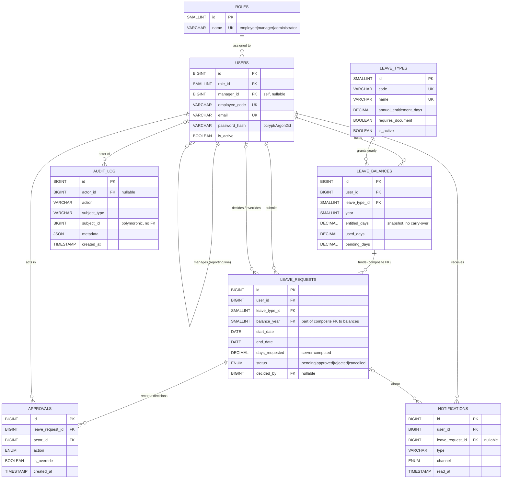

# Data model and database design (MySQL)

Research ticket: [#8](https://github.com/Wynteriall/leave-system/issues/8)
Map: [#1](https://github.com/Wynteriall/leave-system/issues/1)
Status: complete, ready for the grilling / approval ticket.

Scope note: this is written framework-agnostically, at plain MySQL DDL level. Table, column, key,
constraint and index choices stand on their own regardless of the application framework. Section 5
notes where an ORM (e.g. Eloquent, Doctrine, Hibernate, EF Core) maps onto the design; it does not
assume one. This document complements - it does not duplicate - the stack research in
`research/tech-stack.md`, whose data-model sketch this work deepens and makes presentation-ready.

---

## 1. ERD summary

Eight core tables, plus two small optional support tables noted in section 3.9. The model is a
classic "identity + reference data + transactional fact + append-only history" shape: a fixed role
lookup, users with a self-referencing reporting line, admin-configured leave types, a year-keyed
balance fact, leave requests as the main transaction, and two append-only trails (domain decisions
in `approvals`, security/config events in `audit_log`).

### 1.1 Mermaid ER diagram

### 1.2 Relationships and cardinalities (the prose version)

| Relationship | Cardinality | Notes |
| --- | --- | --- |
| `ROLES` -> `USERS` | 1 : 0..N | Every user has exactly one role; a role has many users. Exactly three seeded roles. |
| `USERS` -> `USERS` (manager) | 0..1 : 0..N | Self-referencing `manager_id`. An employee has at most one manager; a manager has many reports; top-level users have none. |
| `USERS` -> `LEAVE_BALANCES` | 1 : 0..N | One row per employee per leave type per year. |
| `LEAVE_TYPES` -> `LEAVE_BALANCES` | 1 : 0..N | A type grants an entitlement to many employees each year. |
| `LEAVE_BALANCES` -> `LEAVE_REQUESTS` | 1 : 0..N | A request draws from exactly one `(user, leave_type, year)` balance row, enforced by a composite FK. |
| `USERS` -> `LEAVE_REQUESTS` (requester) | 1 : 0..N | The employee who submitted it. |
| `USERS` -> `LEAVE_REQUESTS` (decider) | 0..1 : 0..N | `decided_by` is NULL while pending; manager decides, admin overrides/cancels. |
| `LEAVE_REQUESTS` -> `APPROVALS` | 1 : 0..N | Append-only decision timeline; never delete history. |
| `USERS` -> `APPROVALS` | 1 : 0..N | The actor (manager or admin). |
| `USERS` -> `AUDIT_LOG` | 0..1 : 0..N | Nullable actor for system events. |
| `USERS` -> `NOTIFICATIONS` | 1 : 0..N | In-app inbox. |
| `LEAVE_REQUESTS` -> `NOTIFICATIONS` | 0..1 : 0..N | Optional link to the triggering request. |

---

## 2. Conventions adopted across the schema

These choices apply to every table and are the ones worth stating out loud in a presentation.

- **Engine and charset.** `ENGINE=InnoDB` for all tables (transactional, row-level locking, foreign
  keys). `DEFAULT CHARSET=utf8mb4` with a Unicode collation for all text, so names and free-text
  reasons are safe. MySQL 8.4 defaults to `utf8mb4`; being explicit avoids environment drift.
- **Surrogate keys.** `BIGINT UNSIGNED AUTO_INCREMENT` on transactional/history tables,
  `SMALLINT UNSIGNED` on the two fixed lookup tables. No business meaning in primary keys.
- **Referential actions.** Reference data and facts are protected with `ON DELETE RESTRICT` (the
  default `NO ACTION` is equivalent in InnoDB). Disposable or nullable pointers use `SET NULL` /
  `CASCADE` only where a row's disappearance is harmless. Note that `SET NULL` requires the child
  column to be nullable - MySQL will reject the FK otherwise.
- **Soft deactivation, not deletion.** Users and leave types get `is_active`; history keeps its FK
  targets. Hard-deleting a user would orphan balances, requests and audit rows, so the app never
  does it.
- **Exact arithmetic for days.** Entitlements and day counts use `DECIMAL(6,2)`, not `FLOAT`/`DOUBLE`,
  so half-days and fractions are exact and comparisons are reliable. (Float types are approximate.)
- **Closed vocabularies.** `ENUM` for small, fixed, never-reordered sets (request status, approval
  action, notification channel/type); a lookup table for `roles` because it is referenced by FK and
  displayed. `ENUM` values are stored as compact numeric indexes but read back as strings; invalid
  input under strict SQL mode is an error, under non-strict mode it becomes the empty-string error
  value - another reason to keep strict mode on in the local DB.
- **Enforced CHECK constraints.** MySQL 8.0.16+ enforces `CHECK`; 8.4 does so fully. CHECK expressions
  are row-local (no subqueries, no other-table references), so they cover within-row invariants only
  and must be deterministic. Cross-row rules (overlap, available balance) are enforced in the
  application inside a transaction (section 4).
- **Append-only history.** `approvals` and `audit_log` are written once and never updated or deleted.
  MySQL has no declarative "immutable table", so this is a documented convention backed by DB
  grants / application discipline, not a SQL constraint.
- **Timestamps.** `created_at TIMESTAMP NOT NULL DEFAULT CURRENT_TIMESTAMP`,
  `updated_at TIMESTAMP ... ON UPDATE CURRENT_TIMESTAMP` where rows mutate. `TIMESTAMP` is
  timezone-aware in MySQL (stored UTC, converted on retrieval), which suits a local demo whose app
  may render in the user's zone.

---

## 3. Table outlines

### 3.1 `roles` - fixed role lookup

| Column | Type | Null | Key | Notes |
| --- | --- | --- | --- | --- |
| `id` | `SMALLINT UNSIGNED` | no | PK, AI | 1 = employee, 2 = manager, 3 = administrator (seeded). |
| `name` | `VARCHAR(32)` | no | UNIQUE | `employee`, `manager`, `administrator`. |
| `description` | `VARCHAR(255)` | yes | - | Human-readable blurb for the admin UI. |

Constraints: exactly three seed rows; not user-editable at runtime. Application authorization never
trusts a client-supplied role string - it reads `role_id` from the authenticated session/DB.

### 3.2 `users` - employees (and managers/admins, who are also users)

| Column | Type | Null | Key | Notes |
| --- | --- | --- | --- | --- |
| `id` | `BIGINT UNSIGNED` | no | PK, AI | Surrogate identity. |
| `role_id` | `SMALLINT UNSIGNED` | no | FK -> `roles.id` | `ON DELETE RESTRICT`. |
| `manager_id` | `BIGINT UNSIGNED` | yes | FK -> `users.id` | Self-reference; `ON DELETE SET NULL`; NULL for top of chain. |
| `employee_code` | `VARCHAR(32)` | no | UNIQUE | Stable, human-facing identifier (e.g. `EMP-001`). |
| `name` | `VARCHAR(100)` | no | - | Display name. |
| `email` | `VARCHAR(255)` | no | UNIQUE | Login id; store canonical form / rely on case-insensitive collation. |
| `password_hash` | `VARCHAR(255)` | no | - | bcrypt/Argon2id hash string; never plaintext, never logged. |
| `is_active` | `BOOLEAN` | no | - | Default `TRUE`; soft deactivation preserves history. |
| `email_verified_at` | `TIMESTAMP` | yes | - | Optional verification state. |
| `failed_login_attempts` | `SMALLINT UNSIGNED` | no | - | Default 0; throttle counter (frameworks may keep this in cache instead). |
| `locked_until` | `TIMESTAMP` | yes | - | Optional lockout window. |
| `last_login_at` | `TIMESTAMP` | yes | - | Security-visible audit convenience. |
| `created_at`, `updated_at` | `TIMESTAMP` | no | - | Standard timestamps. |

Indices: `UNIQUE(email)`, `UNIQUE(employee_code)`, `INDEX(role_id)`, `INDEX(manager_id)` (FK
columns are auto-indexed by InnoDB, but naming them makes the intent explicit). CHECK optional:
`CHECK (failed_login_attempts >= 0)`.

### 3.3 `leave_types` - admin-configurable

| Column | Type | Null | Key | Notes |
| --- | --- | --- | --- | --- |
| `id` | `SMALLINT UNSIGNED` | no | PK, AI | |
| `code` | `VARCHAR(16)` | no | UNIQUE | Stable short key (`ANNUAL`, `SICK`, `UNPAID`). |
| `name` | `VARCHAR(64)` | no | UNIQUE | Display name. |
| `description` | `VARCHAR(255)` | yes | - | |
| `annual_entitlement_days` | `DECIMAL(6,2)` | no | - | Yearly grant; `CHECK (annual_entitlement_days >= 0)`. |
| `requires_document` | `BOOLEAN` | no | - | Default `FALSE` (e.g. sick note). |
| `is_active` | `BOOLEAN` | no | - | Default `TRUE`; deactivate instead of delete so old balances/requests keep their type. |
| `created_at`, `updated_at` | `TIMESTAMP` | no | - | |

Important: this table holds the *current configured* entitlement. Each balance row snapshots the
value at grant time (section 3.4), so an admin raising "annual leave" from 20 to 25 days does not
silently rewrite last year's entitlement. Every change to this table should also emit an
`audit_log` row (section 3.7).

### 3.4 `leave_balances` - entitlement / balance per employee-type-year

| Column | Type | Null | Key | Notes |
| --- | --- | --- | --- | --- |
| `id` | `BIGINT UNSIGNED` | no | PK, AI | |
| `user_id` | `BIGINT UNSIGNED` | no | FK -> `users.id` | `ON DELETE RESTRICT`. |
| `leave_type_id` | `SMALLINT UNSIGNED` | no | FK -> `leave_types.id` | `ON DELETE RESTRICT`. |
| `year` | `SMALLINT UNSIGNED` | no | UK (composite) | Calendar year, e.g. 2026; `CHECK (year BETWEEN 2000 AND 2100)`. |
| `entitled_days` | `DECIMAL(6,2)` | no | - | Snapshot of `leave_types.annual_entitlement_days` at grant; `CHECK (>= 0)`. |
| `used_days` | `DECIMAL(6,2)` | no | - | Days from approved requests; default 0; `CHECK (>= 0)`. |
| `pending_days` | `DECIMAL(6,2)` | no | - | Days tied up in pending requests; default 0; `CHECK (>= 0)`. |
| `version` | `INT UNSIGNED` | no | - | Default 0; optional optimistic-lock token (alternative to `FOR UPDATE`). |
| `created_at`, `updated_at` | `TIMESTAMP` | no | - | |

Key constraints:

- `UNIQUE (user_id, leave_type_id, year)` - the heart of the entity: exactly one balance row per
  employee, per leave type, per year. A UNIQUE index permits multiple NULLs, which is harmless here
  because all three columns are NOT NULL.
- Table-level `CHECK (used_days + pending_days <= entitled_days)` - within-row guard against
  over-committing days. (Within-row only; a CHECK cannot look at other rows.)
- Composite FK target: this `(user_id, leave_type_id, year)` unique key is what `leave_requests`
  references.

**Yearly reset, no carry-over:** reset is achieved by *keying on `year`*, not by mutating a single
row. At rollover, provisioning inserts a fresh row per active employee x active leave type with
`entitled_days` copied from the current `leave_types` config and `used_days = pending_days = 0`.
Prior-year rows are kept for history; their unused days are deliberately **not** copied forward, so
"no carry-over" is structural rather than a rule someone must remember to apply.

### 3.5 `leave_requests` - the main transaction

| Column | Type | Null | Key | Notes |
| --- | --- | --- | --- | --- |
| `id` | `BIGINT UNSIGNED` | no | PK, AI | |
| `user_id` | `BIGINT UNSIGNED` | no | FK -> `users.id` | Requester; `ON DELETE RESTRICT`. |
| `leave_type_id` | `SMALLINT UNSIGNED` | no | FK -> `leave_types.id` | `ON DELETE RESTRICT`. |
| `balance_year` | `SMALLINT UNSIGNED` | no | FK (part of composite) | Which year's grant funds this request. |
| `start_date` | `DATE` | no | - | Inclusive. |
| `end_date` | `DATE` | no | - | Inclusive; `CHECK (end_date >= start_date)`. |
| `days_requested` | `DECIMAL(6,2)` | no | - | Server-computed from dates + working-day calendar; `CHECK (> 0)`. Never trust a posted value. |
| `reason` | `VARCHAR(1000)` | no | - | Free text; escaped on output (XSS). |
| `status` | `ENUM('pending','approved','rejected','cancelled')` | no | - | Default `pending`. Closed vocabulary; alternative is a 4-row lookup table. |
| `decided_by` | `BIGINT UNSIGNED` | yes | FK -> `users.id` | NULL while pending; `ON DELETE SET NULL`. |
| `decided_at` | `TIMESTAMP` | yes | - | Set when manager decides / admin acts. |
| `decision_note` | `VARCHAR(500)` | yes | - | Reason for rejection/override/cancel. |
| `cancelled_by` | `BIGINT UNSIGNED` | yes | FK -> `users.id` | `ON DELETE SET NULL`; admin cancel. |
| `cancelled_at` | `TIMESTAMP` | yes | - | |
| `created_at`, `updated_at` | `TIMESTAMP` | no | - | |

Key constraints and indices:

- Composite FK: `FOREIGN KEY (user_id, leave_type_id, balance_year) REFERENCES
  leave_balances(user_id, leave_type_id, year) ON DELETE RESTRICT`. This guarantees a balance row
  exists for the year being drawn from. (An ORM may not express this neatly - section 5.)
- `INDEX (user_id, status)` - "my requests" filtered by state.
- `INDEX (status, start_date)` - the manager's approval queue, ordered by date.
- `INDEX (start_date, end_date)` - overlap checks.
- `INDEX (leave_type_id)`, `INDEX (balance_year)` - reporting and year filters.
- Invariant (application-enforced, optionally a table CHECK):
  `(status = 'pending' AND decided_at IS NULL) OR (status <> 'pending' AND decided_at IS NOT NULL)`.
  Keep it in the service layer because admin cancel may legitimately use different columns.

Overlap (no two pending/approved requests from the same employee may intersect) is a range rule that
MySQL cannot express as a CHECK - it is enforced with a query inside the submit transaction
(section 4).

### 3.6 `approvals` - approval history (single-approval workflow)

| Column | Type | Null | Key | Notes |
| --- | --- | --- | --- | --- |
| `id` | `BIGINT UNSIGNED` | no | PK, AI | |
| `leave_request_id` | `BIGINT UNSIGNED` | no | FK -> `leave_requests.id` | `ON DELETE RESTRICT`; history survives. |
| `actor_id` | `BIGINT UNSIGNED` | no | FK -> `users.id` | Manager or admin who acted; `ON DELETE RESTRICT`. |
| `action` | `ENUM('submitted','approved','rejected','overridden','cancelled')` | no | - | Full timeline, including submission. |
| `to_status` | `ENUM('pending','approved','rejected','cancelled')` | yes | - | Resulting request status, if changed. |
| `note` | `VARCHAR(500)` | yes | - | |
| `is_override` | `BOOLEAN` | no | - | Default `FALSE`; TRUE marks an admin override of a prior decision. |
| `created_at` | `TIMESTAMP` | no | - | Default `CURRENT_TIMESTAMP`; immutable event time. |

Indices: `INDEX (leave_request_id, created_at)`, `INDEX (actor_id)`. Append-only: an admin
override or cancel *adds* a row with `is_override = TRUE` and updates the request's current status;
the manager's original decision row is never deleted or rewritten. This is what makes "Admin can
override/cancel" auditable rather than destructive.

### 3.7 `audit_log` - security and configuration events

| Column | Type | Null | Key | Notes |
| --- | --- | --- | --- | --- |
| `id` | `BIGINT UNSIGNED` | no | PK, AI | |
| `actor_id` | `BIGINT UNSIGNED` | yes | FK -> `users.id` | `ON DELETE SET NULL`; NULL for system events. |
| `action` | `VARCHAR(64)` | no | - | e.g. `login.failed`, `role.changed`, `leave_type.created`, `balance.granted`, `admin.override`, `admin.cancel`. |
| `subject_type` | `VARCHAR(64)` | yes | - | Polymorphic target, e.g. `User`, `LeaveRequest`, `LeaveType`. |
| `subject_id` | `BIGINT UNSIGNED` | yes | - | Polymorphic id - intentionally **not** an FK because the target table varies. |
| `metadata` | `JSON` | yes | - | Before/after values, request id, etc. |
| `ip_address` | `VARCHAR(45)` | yes | - | IPv4 or IPv6 (45 chars covers both). |
| `user_agent` | `VARCHAR(255)` | yes | - | Truncated. |
| `created_at` | `TIMESTAMP` | no | - | Default `CURRENT_TIMESTAMP`; immutable. |

Indices: `INDEX (actor_id, created_at)`, `INDEX (action, created_at)`,
`INDEX (subject_type, subject_id)`, `INDEX (created_at)`.

Design notes: `approvals` and `audit_log` are deliberately separate - the former is the
domain decision timeline tied to one request; the latter is the broad security trail (logins,
role/type changes, overrides, cancellations) used for the OWASP A09 logging demo. `JSON` is the
right type for variable-shape metadata; it is validated by MySQL on write. JSON cannot be indexed
directly with an ordinary index - if a specific metadata key ever needs filtering, add a generated
column and index it (section 5). Append-only.

### 3.8 `notifications` - in-app inbox

| Column | Type | Null | Key | Notes |
| --- | --- | --- | --- | --- |
| `id` | `BIGINT UNSIGNED` | no | PK, AI | |
| `user_id` | `BIGINT UNSIGNED` | no | FK -> `users.id` | Recipient; `ON DELETE CASCADE` (disposable). |
| `leave_request_id` | `BIGINT UNSIGNED` | yes | FK -> `leave_requests.id` | `ON DELETE SET NULL`; NULL for non-request notices. |
| `type` | `VARCHAR(48)` | no | - | `request.submitted`, `request.approved`, `request.rejected`, `balance.low`, `entitlement.reset`. |
| `title` | `VARCHAR(150)` | no | - | |
| `body` | `VARCHAR(500)` | yes | - | |
| `channel` | `ENUM('in_app','email')` | no | - | Default `in_app`. Modelled for completeness; email delivery is out of scope for local dev. |
| `read_at` | `TIMESTAMP` | yes | - | NULL = unread. |
| `created_at` | `TIMESTAMP` | no | - | |

Indices: `INDEX (user_id, read_at, created_at)`, `INDEX (leave_request_id)`. This table is the
persistence answer to the "notification/reminder behavior" feature research: state is stored here,
while delivery/reminder scheduling belongs to the application layer.

### 3.9 Optional support tables (implied, not required for the core demo)

- **`calendar_exceptions`** (`date DATE PK`, `is_working_day BOOLEAN`, `note VARCHAR(255)`): makes
  `days_requested` reproducible by recording weekends/holidays that the server-side day calculator
  uses. Without it, the working-day calendar is an application constant.
- **`password_reset_tokens`** (`email VARCHAR(255)`, `token_hash VARCHAR(255)`, `created_at`):
  frameworks that scaffold password reset expect a table like this; otherwise this is framework
  state, not domain state.
- Not modelled: `departments`/`teams` (the reporting line `users.manager_id` already answers
  "manager only sees their reports"), a `permissions` table (authorization is role + policy in code),
  and any attachment table (documents are out of scope for the local demo; only a
  `leave_types.requires_document` flag is recorded).

---

## 4. Integrity rules and transactional invariants

This is the part that turns a set of tables into a correct leave system. Each rule names where it is
enforced, because MySQL CHECK constraints are row-local and cannot express cross-row rules.

1. **Submit.** Before inserting a `leave_requests` row, in one transaction:
   - lock the target balance row with `SELECT ... FOR UPDATE` (or use `version` for optimistic
     locking);
   - reject if `days_requested > entitled_days - used_days - pending_days`;
   - reject if any existing `status IN ('pending','approved')` request for the same user overlaps
     the requested date range (`start_date <= new_end AND end_date >= new_start`);
   - insert the request with `status = 'pending'`, increment `balance.pending_days`, write a
     `submitted` approval row, and enqueue a notification. `FOR UPDATE` is MySQL's locking read: it
     sets exclusive locks on rows and index entries so concurrent transactions cannot update them;
     all locks release at commit/rollback.
2. **Approve (manager).** In one transaction: re-lock the balance, move `days_requested` from
   `pending_days` to `used_days`, set request `status = 'approved'`, `decided_by`, `decided_at`, and
   append an `approved` approval row plus an `audit_log` event. Rejection instead decrements
   `pending_days`, leaves `used_days` untouched, and appends a `rejected` row.
3. **Override / cancel (admin).** Append a new approval row with `is_override = TRUE`, update the
   request status, emit `audit_log`, and reverse any balance effect if an approved request is being
   cancelled (`used_days -= days_requested`). The original manager decision row is never modified.
4. **Yearly reset.** A provisioning job inserts new `leave_balances` rows for the new `year`; no
   row is updated in place and no unused days are carried forward. Old year rows remain queryable.
5. **Append-only logs.** No `UPDATE`/`DELETE` on `approvals` or `audit_log` from application code;
   enforce with narrow DB grants as defence in depth.
6. **Server-side derivation.** `days_requested`, `status`, `decided_by` and every money-like quantity
   are computed/assigned by the server, never taken from hidden form fields - the classic
   insecure-design and broken-access-control demos.
7. **Indexing rationale.** Unique indexes enforce identity rules (email, employee code, type code,
   per-year balance); composite indexes serve the hot paths (approval queue, overlap scan, my
   requests, unread inbox). InnoDB creates an index for each FK automatically, so the explicit FK
   indexes mostly document intent.

---

## 5. Where an ORM maps onto this design

- **Table -> model/entity.** `users`, `roles`, `leave_types`, `leave_balances`, `leave_requests`,
  `approvals`, `audit_log`, `notifications` each become one Eloquent/Doctrine/JPA/EF entity. The
  schema is designed so this mapping is 1:1 - no join tables needed except for the two optional
  support tables.
- **Relationships.** `belongsTo`/`ManyToOne` for each FK; `hasMany` for the inverse; `manager_id` is
  a self-referential `belongsTo`/`hasMany`. The composite FK from `leave_requests` to
  `leave_balances` is the one place an ORM may need help: some ORMs cannot declare it as a native
  association, so keep the DDL in a migration and model the relation as a scoped query
  (`where user_id + leave_type_id + balance_year`) or hide it behind a service.
- **Type casting.** `ENUM` columns map to PHP/Java/TS enums or string casts; `BOOLEAN` to bool;
  `DECIMAL` to a decimal/BigDecimal type (never a float); `JSON` to an array/object cast;
  `TIMESTAMP` to Carbon/DateTime/Instant.
- **Generated/derived values.** `days_requested` and the balance arithmetic stay in a service/DTO,
  not in an ORM accessor, so they are unit-testable and cannot be bypassed by a mass-assignment
  payload. If a generated column is added for a JSON metadata key, map it as a read-only computed
  field.
- **Soft deletes.** Prefer explicit `is_active` scopes (or the ORM's SoftDeletes trait using a
  `deleted_at` column) over physical deletion, because history tables hold FKs to these rows.
- **Transactions and locks.** The balance/approval operations must run inside the ORM's transaction
  wrapper with a row-locking read (e.g. Eloquent `lockForUpdate()`, Django `select_for_update()`,
  JPA `PESSIMISTIC_WRITE`). This is the ORM-level expression of the MySQL `SELECT ... FOR UPDATE`
  rule above.
- **Migrations and seeders.** Migrations reproduce this DDL exactly (including CHECKs and the
  composite FK); seeders insert the three roles and a few leave types. That makes the demo database
  reproducible with one command and is the bridge between this document and the stack research.

---

## 6. Risks and open points for the grilling / approval ticket

1. **Working-day definition.** Half-day support and which days count (weekends, public holidays)
   must be fixed before `days_requested` can be computed deterministically; decide whether
   `calendar_exceptions` is in scope for the demo.
2. **Cross-year requests.** A request spanning 31 Dec -> 2 Jan must pick one `balance_year`. The
   schema stores it explicitly; the business rule (split the request, or charge the start year) is
   still a policy decision.
3. **ENUM vs lookup table.** ENUM is compact and simple for fixed vocabularies but changing a value
   is a DDL `ALTER TABLE`; if the team expects statuses to evolve, switch `status`, `action` and
   `channel` to 4-6 row lookup tables before build starts.
4. **Concurrency proof in the demo.** Show two simultaneous approvals of the last remaining day:
   one must fail. This demonstrates why `FOR UPDATE`/transactions exist rather than being a slide-only
   claim.
5. **Notification scope.** Keep delivery in-app; state explicitly that email/reminder transport is
   out of scope for local dev so the data model's `channel` column is not mistaken for a promise.
6. **Data retention.** No retention/purge policy is modelled (local dev only, synthetic data);
   flag if the course expects one.

---

## 7. Sources

Primary documentation consulted (first-party MySQL 8.4 Reference Manual; URLs are the canonical
pages for these topics):

- Foreign key constraints, referential actions (`RESTRICT`/`CASCADE`/`SET NULL`/`NO ACTION`),
  nullable requirement for `SET NULL`, self-referential FKs, required indexes:
  https://dev.mysql.com/doc/refman/8.4/en/create-table-foreign-keys.html
- CHECK constraints: enforced by default, row-local expressions, no subqueries, deterministic
  functions only: https://dev.mysql.com/doc/refman/8.4/en/create-table-check-constraints.html
- `CREATE INDEX`: composite indexes, UNIQUE indexes (multiple NULLs allowed), functional key parts:
  https://dev.mysql.com/doc/refman/8.4/en/create-index.html
- InnoDB locking reads (`SELECT ... FOR SHARE` / `FOR UPDATE`, locks released at commit):
  https://dev.mysql.com/doc/refman/8.4/en/innodb-locking-reads.html
- The ENUM type: compact storage, index values, invalid-value handling, strict mode:
  https://dev.mysql.com/doc/refman/8.4/en/enum.html
- Generated columns (`VIRTUAL`/`STORED`, indexing, restriction on FKs referencing virtual columns):
  https://dev.mysql.com/doc/refman/8.4/en/create-table-generated-columns.html
- Fixed-point types (`DECIMAL` exact) and integer types:
  https://dev.mysql.com/doc/refman/8.4/en/fixed-point-types.html ,
  https://dev.mysql.com/doc/refman/8.4/en/integer-types.html
- Date and time types (`DATE`, `TIMESTAMP`):
  https://dev.mysql.com/doc/refman/8.4/en/date-and-time-types.html
- The JSON data type:
  https://dev.mysql.com/doc/refman/8.4/en/json.html
- Character sets (`utf8mb4` default in MySQL 8):
  https://dev.mysql.com/doc/refman/8.4/en/charset-unicode-utf8mb4.html

Domain decisions (three roles, single approval with admin override/cancel, admin-configurable leave
types, yearly reset with no carry-over, local-dev-only security focus) come from the parent map
issue #1; the data-model sketch and stack direction in `research/tech-stack.md` were used only for
consistency of table naming and scope.
